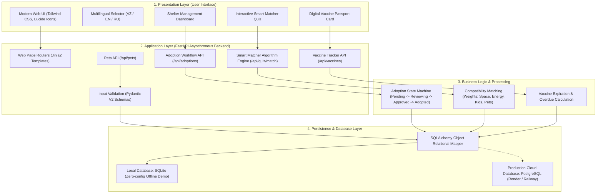

# PawConnect — Software Architecture Record (SW01.5 / D5)

**Project:** PawConnect (Animal Shelter Adoption & Medical Passport System)  
**Competition:** Atlântia International STEM Olympiad  
**Category:** SW01: Software Projects  
**Target Level:** Level 04 / 05 (Junior Explorers / Active Inventors, Ages 10–14)

---

## 1. High-Level Architecture Diagram (Mermaid)

---

## 2. Input $\rightarrow$ Processing $\rightarrow$ Output Model (For Student Defense)

| Step | Component | Description for 10–14 Year Olds |
| :--- | :--- | :--- |
| **INPUT** | User Interface / Web Forms | Vətəndaş və ya sığınacaq işçisi formaya məlumatları daxil edir (məsələn: heyvan növü, ailənin mənzil şəraiti, peyvənd tarixi). |
| **PROCESSING** | FastAPI Backend & Pydantic | Server daxil olan məlumatları `schemas.py` ilə yoxlayır, `api_quiz.py` ilə uyğunluq faizini hesablayır və ya müraciət statusunu dəyişir. |
| **OUTPUT** | Database & UI Render | Nəticə verilənlər bazasında saxlanılır və istifadəçiyə zəngin vizual kartlar, peyvənd pasportu və bildiriş kimi qaytarılır. |

---

## 3. Database Schema Overview

* **Shelter:** Sığınacaqların adı, şəhəri, ünvanı, əlaqə vasitələri.
* **Pet:** Heyvanın adı, növü, cinsi, yaşı, ölçüsü, bioqrafiyası, xarakter xüsusiyyətləri, mikroçip ID-si, sterilizasiya statusu və sahibləndirmə vəziyyəti (`available`, `pending`, `adopted`).
* **VaccineRecord:** Peyvəndin adı, vurulma tarixi, növbəti doza tarixi, partiya nömrəsi, baytar həkim və klinika, status (`valid`, `upcoming`, `overdue`).
* **AdoptionApplication:** Müraciət edənin adı, əlaqə nömrəsi, e-poçtu, yaşayış yeri (mənzil / həyətli ev), evdə uşaq və ya digər heyvanın olub-olmaması, müraciət statusu (`pending`, `reviewing`, `approved`, `rejected`).
